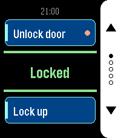
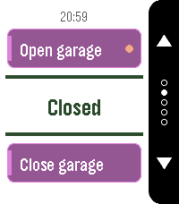
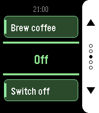
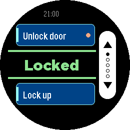
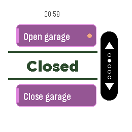
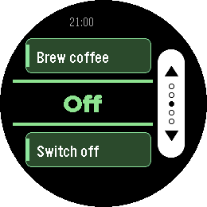

# HA Trigger

*Up to ten Home Assistant actions on five screens, one button each.*

     

A Pebble watchapp (v1.3.0).

HA Trigger puts Home Assistant actions on your wrist and keeps the answer
in front of you.

Each screen carries two actions: the top button runs one, the bottom button
the other. Between them sits the state of an entity of your choice, in large
type and coloured by what it says: green when things are as they should be,
amber while a lock is still turning, red when the entity is unavailable or
Home Assistant did not answer. It refreshes by itself every 15 seconds while
the app is open, so you can read it without pressing anything.

Set up as many as five screens — front door, garage, lights — and flip
through them with the middle button. Only screens with at least one action
are shown, and dots on the button rail tell you where you are. The app
reopens on the screen you left it on.

Give every screen its own colour. Blue for the front door, red for the
attic, green for the coffee machine: the action cards take on the colour
you pick, so you know which screen you are on before you have read a word.
Seven colours are available, each dark enough to keep the white card text
easy to read.

Each action can ask before it fires. Turn the prompt on for anything you do
not want to trigger from a pocket, and the watch shows a countdown ring:
the middle button runs the action, any other button cancels, and doing
nothing cancels it too. Actions with a prompt are marked with a dot on
their card, so you can see which one is the careful one.

Any service works — `lock.open`, `script.turn_on`, `switch.toggle`,
`scene.turn_on`, `cover.open_cover`. Give it a target entity, or leave that
empty for scripts that take no arguments. For the status line, a template
sensor is worth setting up: whatever text it produces is what the watch
shows.

Your settings live on the watch as well as on the phone, and the two sync
in both directions. Reinstall the phone app and the watch hands its
configuration back; reinstall the watch app and the phone restores it. You
should not have to type a long-lived token twice.

Built for Pebble Time 2 and Pebble Round 2, with a layout drawn for each —
a full-height button rail on the rectangular display, a rounded rail set
inside the circle on the round one.

## Settings

- **HA URL** — base URL of your Home Assistant, no path and no trailing
  slash. If you leave out `http://` or `https://` it is assumed to be
  `http://`.
- **Long-Lived Token** — from Profile > Security in Home Assistant. Best
  created under a dedicated, non-administrative user.
- **Screens 1 to 5** — each with its own card colour, status entity and a
  top and bottom action. Leave both actions of a screen empty to hide it.
- **Card Color** — blue, red, green, orange, purple, teal or gray. Screens
  start out in blue, red, green, orange and purple.
- **Status Entity** — shown in the centre of the screen. Leave empty to use
  the top action's entity, or the bottom one's if the top is empty. A
  template sensor works well here.
- **Top / Bottom Action** — a label, a service in `domain.service` form, an
  optional target entity, and whether to ask before running it. For a script,
  scene, automation or button you can name the entity alone and leave the
  action empty — the matching action is derived from it. Without a label the
  card shows the entity's name.
- **Color Scheme** — Dark uses a white button rail on black, Light a black
  rail on white.

## Platforms

- Pebble Time 2 (`emery`)
- Pebble Round 2 (`gabbro`)

## Building

With the [Pebble SDK](https://developer.repebble.com/sdk/):

```bash
pebble build
pebble install --emulator emery
```

The repository can also be imported into CloudPebble as is.

## Release notes

### 1.3.0

- Each screen has its own card colour, chosen from seven, so you can tell the
  screens apart at a glance. Screens 2 to 5 start out in red, green, orange
  and purple; screen 1 keeps its blue.

### 1.2.0

- Up to five screens with two actions and a status entity each. The middle
  button flips between them; empty screens are skipped, and dots on the
  button rail show which screen you are on.
- The status refreshes automatically every 15 seconds while the app is open —
  no more pressing the middle button for it.
- The app reopens on the screen you last used.
- An action without a label shows its entity name on the card.
- Existing settings carry over as screen 1.

### 1.1.1

- A script, scene, automation or button entity now runs without also filling in
  the action field — naming the entity is enough.
- An action written without its dot (`script_my_script`) now says so instead of
  claiming the field is empty.
- Stronger contrast in both themes: cards are dark with white text everywhere,
  and the status colours have separate light and dark variants. Nothing falls
  below a 5:1 contrast ratio any more.
- Side button rail showing what each button does, a countdown ring on the
  confirmation prompt, and the time in the header.
- The status line understands `away`, so a template sensor that gates an action
  on presence shows up red rather than as a normal state.
- Settings survive a reinstall in both directions — the watch restores the
  phone and the phone restores the watch.
- URLs without a scheme, and tokens pasted with line breaks, are repaired
  instead of failing with an unhelpful error.

### 1.0.0

First release.

## License

MIT License, see [LICENSE](LICENSE).
